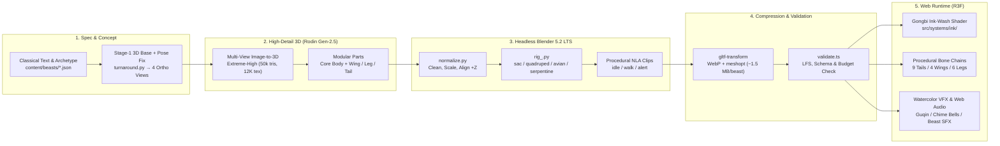

<div align="center">

# 山海异兽录 · Shanhai World

**Interactive 3D Bestiary of the *Classic of Mountains and Seas* (《山海经》) in Real-Time Chinese Gongbi Ink-Wash Style**

[](https://shanhaiworld.org/)
[](https://github.com/int64ago/shanhai/actions/workflows/ci.yml)
[](https://github.com/int64ago/shanhai/actions/workflows/deploy.yml)
[](./LICENSE)
[](./AGENTS.md)

**English** | **[简体中文](./README.zh-CN.md)**

</div>

---

<table>
  <tr>
    <td width="50%" align="center">
      <a href="https://shanhaiworld.org/?beast=jiuweihu&action=special">
        
      </a>
      <br />
      <sub><b>九尾狐 · Jiuweihu</b> (<code>quadruped</code> + 9 procedural tails & cyan fox-fire)</sub>
    </td>
    <td width="50%" align="center">
      <a href="https://shanhaiworld.org/?beast=dijiang&action=special">
        
      </a>
      <br />
      <sub><b>帝江 · Dijiang</b> (<code>sac</code> headless/faceless torso + 4 wings, 6 legs & chime-dance)</sub>
    </td>
  </tr>
</table>

---

## Overview

**Shanhai World (《山海异兽录》)** brings ten mythical creatures from the ancient Chinese cosmography *Classic of Mountains and Seas* (《山海经》) into an interactive Web 3D scroll at **[shanhaiworld.org](https://shanhaiworld.org/)**.

Rather than treating mythical beasts as generic Western fantasy monsters or uncanny photorealistic plastic models, **Shanhai World** combines three core ideas:

1. **Real-Time Gongbi Ink-Wash Rendering (工笔淡彩 + 水墨线描)**: Custom GLSL shaders render two-step watercolor washes with water-edge pooling over rice-paper grain, paired with variable-pressure calligraphic outlines (`src/systems/ink/`).
2. **Archetype-Driven Modular Anatomy**: Mythical creatures in《山海经》do not all have a head, eyes, four legs, or a tail—*Dijiang* is a faceless crimson-ochre sac with six legs and four wings, *Bifang* is a one-legged crane, *Taotie* has eyes under its armpits, and *Kaiming* has nine human-faced heads. Our pipeline models every creature as one of **five anatomical archetypes** (`sac`, `avian`, `serpentine`, `quadruped`, `biped`) plus **modular procedural appendages**.
3. **Philological Integrity**: Every beast card strictly separates **verbatim classical citations (`原文`)** from **modern artistic extrapolations (`设计`)**, displayed in distinct vertical typography columns.

---

## Ten Mythical Beasts Roster

| Beast | Chinese | Classical Citation (《山海经》) | Archetype & Appendages | Status |
| :--- | :--- | :--- | :--- | :---: |
| **Jiuweihu** | 九尾狐 | 《南山经》：“其状如狐而九尾，其音如婴儿，能食人，食者不蛊。” | `quadruped` + 9 staggered tails | ✅ Live |
| **Dijiang** | 帝江 | 《西山经》：“其状如黄囊，赤如丹火，六足四翼，浑敦无面目，是识歌舞。” | `sac` (faceless) + 4 wings + 6 legs | ✅ Live |
| **Bo** | 驳 | 《西山经》：“其状如马，白身黑尾，一角，虎牙爪，音如鼓。” | `quadruped` (unicorned horse) | 🚧 Planned |
| **Luwu** | 陆吾 | 《西山经》：“其神状虎身而九尾，人面而虎爪。” | `quadruped` + 9 tails | 🚧 Planned |
| **Bifang** | 毕方 | 《西山经》：“其状如鹤，一足，赤文青质而白喙，其鸣自叫也。” | `avian` (single central leg) | 🚧 Planned |
| **Qiongqi** | 穷奇 | 《海内北经》：“其状如虎，有翼。” | `quadruped` + 2 feathered wings | 🚧 Planned |
| **Taotie** | 饕餮 | 《北山经》：“其状如羊身人面，其目在腋下，虎齿人爪。” | `quadruped` + underarm eyes | 🚧 Planned |
| **Kaiming** | 开明兽 | 《海内西经》：“身大类虎而九首，皆人面，东向立昆仑上。” | `quadruped` + 9 neck/head chains | 🚧 Planned |
| **Fenghuang** | 凤凰 | 《南山经》：“其状如鸡，五采而文，名曰凤凰。” | `avian` + trailing tail plumes | 🚧 Planned |
| **Yinglong** | 应龙 | 《大荒东经》：“应龙处南极，杀蚩尤与夸父。” | `serpentine` (multi-bone spine + wings) | 🚧 Planned |

---

## Architecture & Pipeline



---

## Quick Start

### Prerequisites

- **Node.js** `>= 22` (Node `24` recommended)
- **pnpm** `>= 10`
- **Git LFS** (`git lfs install` — required to pull `.glb` and `.png` binary assets)
- **Blender** `5.2 LTS` at `/Applications/Blender.app` *(only needed when running the offline 3D asset build pipeline)*

### Run Locally

```bash
git clone git@github.com:int64ago/shanhai.git
cd shanhai
git lfs pull
pnpm install
pnpm dev
```

Open `http://localhost:5173` (or pass `?beast=dijiang&action=special` to jump directly to a beast and action).

### Build & Validate

```bash
pnpm typecheck   # TypeScript check across app and pipeline
pnpm validate    # Verify Git LFS binaries, beast JSON schemas, and <= 15 MB budget
pnpm build       # Production build into dist/
```

---

## Offline 3D Asset Pipeline

If you have Blender 5.2 LTS installed and a Hyper3D Rodin API key in `.env.local` (copied from `.env.example`), you can generate and rig beasts end-to-end from the command line:

```bash
# Check Rodin API credit balance
pnpm rodin:balance

# Submit / poll / cache a Rodin generation job
pnpm rodin pipeline/rodin/jobs/dijiang-body-max.json

# Run headless Blender normalization, archetype rigging, and gltf-transform compression
pipeline/build_beast.sh dijiang dijiang-body-max wing:dijiang-wing-max:0.55 leg:dijiang-leg-max:0.20
```

---

## Automated Deployment to Cloudflare (`shanhaiworld.org`)

Every push to `main` triggers [`.github/workflows/deploy.yml`](./.github/workflows/deploy.yml), which validates all LFS assets, builds the production bundle, and deploys to **[https://shanhaiworld.org/](https://shanhaiworld.org/)** via Cloudflare Workers Static Assets ([`wrangler.jsonc`](./wrangler.jsonc)).

To enable automatic deployment on your fork or repository, add two secrets under **GitHub Repository → Settings → Secrets and variables → Actions**:

| Secret | Description |
| :--- | :--- |
| `CLOUDFLARE_API_TOKEN` | Cloudflare API token with **Workers Scripts: Edit** and **Workers Routes: Edit** permissions for `shanhaiworld.org` |
| `CLOUDFLARE_ACCOUNT_ID` | Your 32-character Cloudflare Account ID |

---

## AI Agent Compatibility

This repository is structured for seamless collaboration across **Claude Code, OpenAI Codex, Grok, Cursor, Windsurf, GitHub Copilot, and web-browsing LLM agents**:

- **[`AGENTS.md`](./AGENTS.md)**: Universal agent engineering guide (architecture, commands, React 19 `StrictMode` scene-graph rules, GLSL ink shader invariants, and Git LFS rules).
- **[`CLAUDE.md`](./CLAUDE.md)** & **[`.claude/skills/build-beast/SKILL.md`](./.claude/skills/build-beast/SKILL.md)**: Claude Code entry point and the reusable `/build-beast` skill covering all 5 anatomical archetypes.
- **[`.cursorrules`](./.cursorrules)** & **[`.github/copilot-instructions.md`](./.github/copilot-instructions.md)**: Instructions for Cursor, Windsurf, and GitHub Copilot Coding Agent.
- **[`public/llms.txt`](./public/llms.txt)**: Machine-readable summary served at `https://shanhaiworld.org/llms.txt`.

---

## License

Code is released under the **[MIT License](./LICENSE)**. Third-party and AI-generated asset attributions are tracked in [`content/asset-credits.json`](./content/asset-credits.json).
