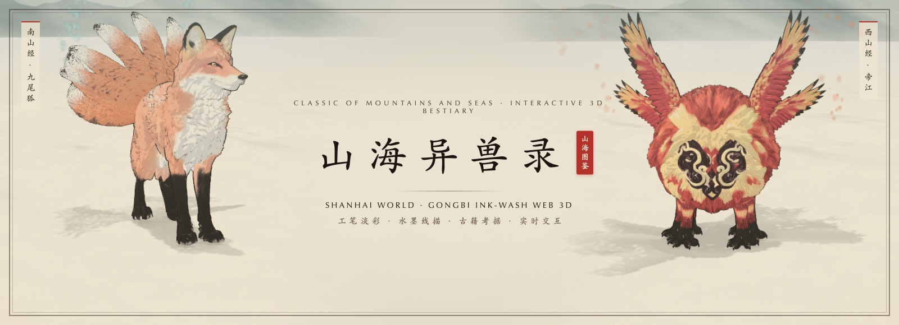

<div align="center">

<a href="https://shanhaiworld.org/">
  
</a>

<br />

[](https://shanhaiworld.org/)
[](https://github.com/int64ago/shanhai/actions/workflows/ci.yml)
[](https://github.com/int64ago/shanhai/actions/workflows/deploy.yml)
[](./AGENTS.md)
[](./LICENSE)

<p align="center">
  <a href="./README.md">English</a> &nbsp;·&nbsp; <b>简体中文</b> &nbsp;·&nbsp; <a href="https://shanhaiworld.org/">打开线上图鉴 ↗</a>
</p>

</div>

---

**《山海异兽录》（Shanhai World，[shanhaiworld.org](https://shanhaiworld.org/)）** 是一部在浏览器中展开的《山海经》十八卷 **62 尊代表异兽**实时 Web 3D 互动图鉴，以**国风工笔淡彩 + 水墨线描**结合**古风评书人语音解说**重现上古异兽。

---

## 核心理念

- **工笔淡彩 + 毛笔提按墨线（`src/systems/ink/`）** — 受光面留纸白、背光面作两道水彩分染带水渍边，配随位置粗细变化的反向外壳墨线，整幅画面融于宣纸纤维、青绿远山与流动云雾之中。
- **五大解剖构型 + 异体器官挂接** — 《山海经》异兽不预设必有头、五官、四足或尾巴。管线按 **`sac`（浑沌囊体）**、**`avian`（羽禽/奇足禽）**、**`serpentine`（长龙游弋）**、**`quadruped`（走兽）**、**`biped`（直立异神）** 五类构型绑骨，并在运行时组合九尾、四翼、六足、九首、腋下目等动态骨骼链。
- **十八卷山海总目 + 评书人语音解说（`pipeline/tts/`）** — 底部二级长卷支持按 **八大卷域**（南山、西山、北山、东山、中山、海外、海内、大荒）翻阅，配合全屏 **「山海总目」** 检索面板、生僻字注音、原典与 3D 造型拆解分栏，以及基于百炼 CosyVoice（`longsanshu` 龙三叔）合成的惊堂木评书解说。

---

## 十神兽图鉴与构型

| 神兽 | 《山海经》原文出处 | 躯干构型 | 异体挂接与特性 | 状态 |
| :--- | :--- | :--- | :--- | :---: |
| **[九尾狐 · Jiuweihu](https://shanhaiworld.org/?beast=jiuweihu)** | 《南山经》：“其状如狐而九尾，其音如婴儿，能食人，食者不蛊。” | `quadruped` | 9 条奇偶错层尾链 + 青绿水彩狐火 + 婴啼合成音 | **已上线** |
| **[帝江 · Dijiang](https://shanhaiworld.org/?beast=dijiang)** | 《西山经》：“其状如黄囊，赤如丹火，六足四翼，浑敦无面目，是识歌舞。” | `sac`（无面目） | 四翼错相扑动 + 六足三脚架步态 + 编钟囊鼓歌舞 | **已上线** |
| **驳 · Bo** | 《西山经》：“其状如马，白身黑尾，一角，虎牙爪，音如鼓。” | `quadruped` | 独角马身 + 鼓音胸腔脉动 | 制作中 |
| **陆吾 · Luwu** | 《西山经》：“其神状虎身而九尾，人面而虎爪。” | `quadruped` | 人面虎躯 + 9 条尾链 | 制作中 |
| **毕方 · Bifang** | 《西山经》：“其状如鹤，一足，赤文青质而白喙，其鸣自叫也。” | `avian` | 单足居中（`x = 0`）+ 讹火翎羽 | 制作中 |
| **穷奇 · Qiongqi** | 《海内北经》：“其状如虎，有翼。” | `quadruped` | 虎躯 + 双翼链 | 制作中 |
| **饕餮 · Taotie** | 《北山经》：“其状如羊身人面，其目在腋下，虎齿人爪。” | `quadruped` | 羊身人面 + 腋下双目 | 制作中 |
| **开明兽 · Kaiming** | 《海内西经》：“身大类虎而九首，皆人面，东向立昆仑上。” | `quadruped` | 虎躯 + 9 条人面颈链 | 制作中 |
| **凤凰 · Fenghuang** | 《南山经》：“其状如鸡，五采而文，名曰凤凰。” | `avian` | 五采羽躯 + 长尾翎链 | 制作中 |
| **应龙 · Yinglong** | 《大荒东经》：“应龙处南极，杀蚩尤与夸父。” | `serpentine` | 32 节脊椎行波 + 双翼 | 制作中 |

---

## 自动化 3D 生产管线

每只神兽均通过脚本化管线（`pipeline/build_beast.sh`）一键构建：

| 阶段 | 工具与脚本 | 说明 |
| :--- | :--- | :--- |
| **1. 考据与拆解** | `content/beasts/<id>.json` | 定义《山海经》原文、设计推断、主躯干 `archetype` 与外挂器官任务。 |
| **2. 两阶段 3D 生成** | `pipeline/rodin/generate.ts` + `turnaround.py` | 先生成初版基底，在无头 Blender 中矫正姿态并渲染正交四视图（`concept/<id>/`），再走 Rodin Gen-2.5 `Extreme-High`（5 万面 + 4K 贴图）。 |
| **3. 按构型自动绑骨** | `pipeline/blender/rig_<archetype>.py` | 尺寸与朝向归一（`+Z` 朝前、`z = 0` 落地），按构型生成骨架与三层权重兜底，写入 `idle` / `walk` / `alert` 循环动画。 |
| **4. 压缩与校验** | `gltf-transform` + `pipeline/validate.ts` | 贴图转 WebP、几何 `meshopt` 压缩（单兽约 1.5 MB），自动校验 Git LFS 二进制完整性与 ≤ 15 MB 预算。 |
| **5. 水墨运行时** | `src/systems/ink/` + `src/beasts/<id>/` | 工笔淡彩分染、毛笔提按外轮廓、动态器官骨骼链、水彩粒子与 Web Audio 合成音效。 |

---

## 快速开始

需安装 **Node.js >= 22**、**pnpm >= 10** 与 **Git LFS**（`git lfs install`）。

```bash
git clone git@github.com:int64ago/shanhai.git
cd shanhai && git lfs pull
pnpm install
pnpm dev
```

```bash
pnpm typecheck   # TypeScript 全量类型检查
pnpm validate    # 校验 Git LFS 模型二进制、神兽 JSON 结构与 <= 15 MB 体积上限
pnpm build       # 构建生产包至 dist/
```

---

## AI Agent 原生支持

仓库针对 **Claude Code、OpenAI Codex、Grok、Cursor、Windsurf、GitHub Copilot** 等智能体做了完整适配：

| 文件 | 适用智能体 | 作用 |
| :--- | :--- | :--- |
| **[`AGENTS.md`](./AGENTS.md)** | Codex、Grok、Cursor、Windsurf、Devin、Claude | 工程架构、常用命令、React 19 `StrictMode` 场景树挂载铁律、水墨着色器约束与 Git LFS 规范。 |
| **[`CLAUDE.md`](./CLAUDE.md)** | Claude Code | Claude Code 快速入口与自检清单。 |
| **[`.claude/skills/build-beast/SKILL.md`](./.claude/skills/build-beast/SKILL.md)** | Claude Code（`/build-beast`）及所有 Agent | 覆盖 5 大解剖构型的 6 步神兽制作与无头浏览器视觉自检技能。 |
| **[`.cursorrules`](./.cursorrules)** 与 **[`.github/copilot-instructions.md`](./.github/copilot-instructions.md)** | Cursor、Windsurf、GitHub Copilot | 编辑器与 PR 智能体上下文规则。 |
| **[`public/llms.txt`](./public/llms.txt)** | 联网检索 Agent（`shanhaiworld.org/llms.txt`） | 机器可读的项目与十神兽考据摘要。 |

---

## 自动部署（`shanhaiworld.org`）

推送至 `main` 分支会自动执行 [`.github/workflows/ci.yml`](./.github/workflows/ci.yml) 与 [`.github/workflows/deploy.yml`](./.github/workflows/deploy.yml)，通过 [`wrangler.jsonc`](./wrangler.jsonc) 部署至 **[https://shanhaiworld.org/](https://shanhaiworld.org/)**。在仓库 **Settings → Secrets and variables → Actions** 中配置 `CLOUDFLARE_API_TOKEN` 与 `CLOUDFLARE_ACCOUNT_ID` 后即可自动发布线上环境。

---

## 开源许可

代码基于 **[MIT License](./LICENSE)** 开源；资产授权记录见 [`content/asset-credits.json`](./content/asset-credits.json)。
