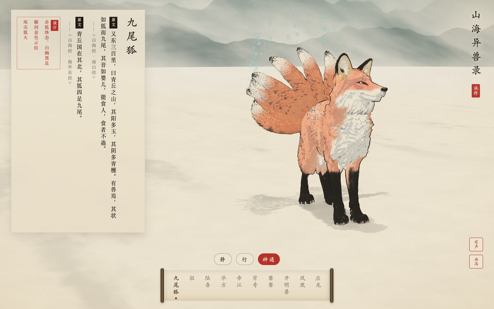
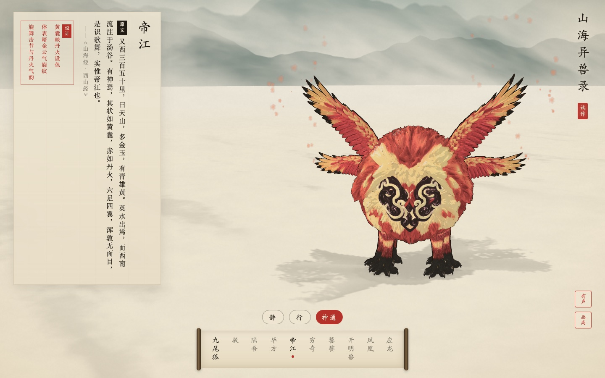

<div align="center">

# 山海异兽录 · Shanhai World

**基于国风工笔淡彩与水墨线描的《山海经》实时 Web 3D 互动图鉴**

[](https://shanhaiworld.org/)
[](https://github.com/int64ago/shanhai/actions/workflows/ci.yml)
[](https://github.com/int64ago/shanhai/actions/workflows/deploy.yml)
[](./LICENSE)
[](./AGENTS.md)

**[English](./README.md)** | **简体中文**

</div>

---

<table>
  <tr>
    <td width="50%" align="center">
      <a href="https://shanhaiworld.org/?beast=jiuweihu&action=special">
        
      </a>
      <br />
      <sub><b>九尾狐 · Jiuweihu</b>（<code>quadruped</code> 走兽构型 + 九尾错层行波 + 青绿狐火）</sub>
    </td>
    <td width="50%" align="center">
      <a href="https://shanhaiworld.org/?beast=dijiang&action=special">
        
      </a>
      <br />
      <sub><b>帝江 · Dijiang</b>（<code>sac</code> 浑沌无面目囊体构型 + 四翼六足 + 编钟丹火歌舞）</sub>
    </td>
  </tr>
</table>

---

## 项目简介

**《山海异兽录》（Shanhai World，[shanhaiworld.org](https://shanhaiworld.org/)）** 是一部在浏览器中展开的《山海经》十神兽实时 3D 互动图鉴。

项目围绕三个核心设计原则构建：

1. **国风工笔淡彩 + 水墨线描渲染**：自研 GLSL 水墨着色器（`src/systems/ink/`），受光面留纸白、背光面作两道水彩分染带水渍边，配随位置粗细起伏的毛笔提按墨线，整幅画面压入宣纸纤维、青绿远山与流动云雾之中。
2. **“主躯干构型 + 异体器官挂接”通用管线**：《山海经》异兽不预设必有头、五官、四足或尾巴——帝江浑敦无面目而六足四翼、毕方一足、饕餮目在腋下、开明兽九首人面。管线将神兽抽象为 **5 类基础构型**（`sac` 浑沌囊体、`avian` 羽禽/奇足禽、`serpentine` 长龙游弋、`quadruped` 走兽、`biped` 直立异人）加 **模块化动态器官链**。
3. **古籍原文与设计推断严格分栏**：左侧竖排古籍卡片中，**`原文`** 仅收录《山海经》逐字原文与篇目，所有现代视觉补足（设色、纹样、神通特效）一律归入朱框 **`设计`** 栏，绝不混排。

---

## 十神兽图鉴

| 神兽 | 英文 | 《山海经》原文出处 | 构型与异体挂接 | 状态 |
| :--- | :--- | :--- | :--- | :---: |
| **九尾狐** | Jiuweihu | 《南山经》：“其状如狐而九尾，其音如婴儿，能食人，食者不蛊。” | `quadruped` + 9 条错层动态尾链 | ✅ 已上线 |
| **帝江** | Dijiang | 《西山经》：“其状如黄囊，赤如丹火，六足四翼，浑敦无面目，是识歌舞。” | `sac`（无面目）+ 四翼 + 六足 | ✅ 已上线 |
| **驳** | Bo | 《西山经》：“其状如马，白身黑尾，一角，虎牙爪，音如鼓。” | `quadruped`（独角马身） | 🚧 制作中 |
| **陆吾** | Luwu | 《西山经》：“其神状虎身而九尾，人面而虎爪。” | `quadruped` + 9 条尾链 | 🚧 制作中 |
| **毕方** | Bifang | 《西山经》：“其状如鹤，一足，赤文青质而白喙，其鸣自叫也。” | `avian`（单足居中） | 🚧 制作中 |
| **穷奇** | Qiongqi | 《海内北经》：“其状如虎，有翼。” | `quadruped` + 双翼链 | 🚧 制作中 |
| **饕餮** | Taotie | 《北山经》：“其状如羊身人面，其目在腋下，虎齿人爪。” | `quadruped` + 腋下双目 | 🚧 制作中 |
| **开明兽** | Kaiming | 《海内西经》：“身大类虎而九首，皆人面，东向立昆仑上。” | `quadruped` + 9 条人面虎首颈链 | 🚧 制作中 |
| **凤凰** | Fenghuang | 《南山经》：“其状如鸡，五采而文，名曰凤凰。” | `avian` + 五彩尾翎链 | 🚧 制作中 |
| **应龙** | Yinglong | 《大荒东经》：“应龙处南极，杀蚩尤与夸父。” | `serpentine`（多节脊椎行波 + 双翼） | 🚧 制作中 |

---

## 快速开始

### 环境要求

- **Node.js** `>= 22`（推荐 Node `24`）
- **pnpm** `>= 10`
- **Git LFS**（`git lfs install`，用于拉取 `.glb` 与 `.png` 模型资产）
- **Blender** `5.2 LTS`（默认路径 `/Applications/Blender.app`，仅在运行离线 3D 生产管线时需要）

### 本地运行

```bash
git clone git@github.com:int64ago/shanhai.git
cd shanhai
git lfs pull
pnpm install
pnpm dev
```

浏览器打开 `http://localhost:5173`（支持通过 URL 参数直接跳转指定神兽与动作，如 `?beast=dijiang&action=special`）。

### 校验与构建

```bash
pnpm typecheck   # TypeScript 全量类型检查
pnpm validate    # 校验 Git LFS 二进制完整性、神兽设定 JSON 结构与 <= 15MB 体积预算
pnpm build       # 生产环境分包构建至 dist/
```

---

## 离线 3D 素材管线

配置 `.env.local` 中的 `HYPER3D_API_KEY`（参考 `.env.example`）并安装 Blender 5.2 LTS 后，可通过命令行一键完成生成、清理、按构型绑骨、生成动作与压缩：

```bash
# 查询剩余积分
pnpm rodin:balance

# 提交 / 轮询 / 缓存 Rodin 3D 生成任务
pnpm rodin pipeline/rodin/jobs/dijiang-body-max.json

# 按构型自动清理、绑骨、生成三段动画并输出 WebP + meshopt 压缩 GLB
pipeline/build_beast.sh dijiang dijiang-body-max wing:dijiang-wing-max:0.55 leg:dijiang-leg-max:0.20
```

---

## GitHub Actions 自动部署至 Cloudflare（`shanhaiworld.org`）

每次推送到 `main` 分支会自动触发 [`.github/workflows/deploy.yml`](./.github/workflows/deploy.yml)，完成 Git LFS 模型校验、生产构建，并通过 [`wrangler.jsonc`](./wrangler.jsonc) 部署至 **[https://shanhaiworld.org/](https://shanhaiworld.org/)**。

在 GitHub 仓库的 **Settings → Secrets and variables → Actions** 中配置以下两个 Secret 即可启用自动部署：

| Secret 名称 | 说明 |
| :--- | :--- |
| `CLOUDFLARE_API_TOKEN` | 具备 `shanhaiworld.org` 所在账号 **Workers Scripts: Edit** 与 **Workers Routes: Edit** 权限的 API Token |
| `CLOUDFLARE_ACCOUNT_ID` | 32 位 Cloudflare Account ID |

---

## AI Agent 友好支持

本工程原生适配 **Claude Code、OpenAI Codex、Grok、Cursor、Windsurf、GitHub Copilot** 等各类智能体：

- **[`AGENTS.md`](./AGENTS.md)**：面向所有编码 Agent 的工程规范（架构概览、常用命令、五类构型约定、React 19 `StrictMode` 场景树挂载铁律、水墨着色器约束与 Git LFS 规则）。
- **[`CLAUDE.md`](./CLAUDE.md)** 与 **[`.claude/skills/build-beast/SKILL.md`](./.claude/skills/build-beast/SKILL.md)**：Claude Code 入口说明与通用的 `/build-beast` 神兽制作技能。
- **[`.cursorrules`](./.cursorrules)** 与 **[`.github/copilot-instructions.md`](./.github/copilot-instructions.md)**：Cursor、Windsurf 与 GitHub Copilot 专用规则。
- **[`public/llms.txt`](./public/llms.txt)**：部署于 `https://shanhaiworld.org/llms.txt` 的结构化项目摘要，方便联网检索 Agent 读取。

---

## 开源许可

代码采用 **[MIT License](./LICENSE)** 开源；第三方与 AI 生成资产授权记录见 [`content/asset-credits.json`](./content/asset-credits.json)。
