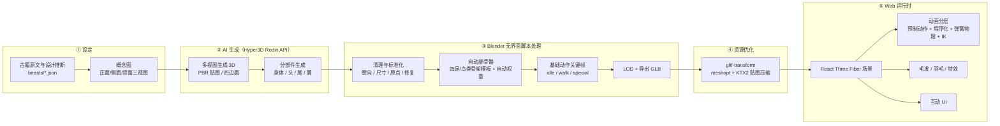

# 山海经十神兽 · 国风工笔水墨 Web 3D 互动项目实施计划

> [!IMPORTANT]
> 状态：**M0 / M1 / M2（九尾狐试点）已完成并验收通过**。后续 9 只神兽复用 `.claude/skills/build-beast/SKILL.md` 工作流推进。

---

## 1. 目标与验收标准

### 1.1 最终产物
一个在浏览器里打开的国风工笔水墨 3D 互动图鉴，暂定叫《山海异兽录》：
- 收录 10 只神兽：应龙、开明兽、陆吾、凤凰、驳、饕餮、穷奇、帝江、九尾狐、毕方
- 每只都能自由旋转观察、切换动作（静 / 行 / 神通）、靠近时触发警觉反应
- 每只配有古籍原文卡片，**严格区分"原文"和"设计推断"**

### 1.2 量化验收指标
| 维度 | 指标 |
| :--- | :--- |
| 画面 | 工笔淡彩分染 + 毛笔提按墨线外轮廓 + 宣纸肌理 + 远山云雾与墨色晕影；以 1080p 截图看，神兽与背景统一在宣纸画卷质感中，无塑料感与穿模黑斑 |
| 生动 | 每只至少 3 段动作（静 / 行 / 神通），动作之间平滑过渡（≤0.3s）；尾巴、龙须、羽翎有错层行波摆动；头部随自身动作自然呼吸，不跟随鼠标扭动 |
| 性能 | M 系列 Mac + Chrome **稳定 60fps**；中端手机 ≥30fps（自动降级画质） |
| 加载 | 单只神兽资源 ≤ 15MB（压缩后，实测九尾狐仅 1.5MB）；首屏 ≤ 3s 出画面，模型按需懒加载 |
| 兼容 | 优先 WebGPU，不支持时自动退回 WebGL2 |
| 声音 | 每只至少 1 段环境氛围 + 2 种叫声 / 动作音效；首次交互后才出声，有静音开关 |

### 1.3 画面风格：国风工笔淡彩 + 水墨写意（方案 A）
经 M2 九尾狐试点对比验证，放弃照片级 PBR 写实，全面采用**工笔淡彩设色 + 墨线勾勒**的国风 3D 渲染：
- **生物本体**：受光面留纸白，背光面两道水彩分染带水渍边；五官（瞳孔、眼线、鼻吻）与四足黑袜、耳尖入浓墨，外轮廓加随位置粗细起伏的毛笔提按墨线
- **奇异部件**（九尾、羽翼等）：顺毛笔触 + 末梢留白与飞白收笔 + 细墨线勾边，与本体画风统一
- **特效语言**：禁用在浅色宣纸上会冲白失效的西式加法发光，改用青绿 / 朱砂水彩晕染粒子（中心淡、边缘积色水痕）
- **环境**：宣纸色天幕、四层青绿远山、多层流动云雾、宣纸皴擦地面与墨色接触晕影，整幅画面叠宣纸纤维暗角
- **UI**：宣纸、卷轴、朱砂印章、竖排古籍字体（从右向左分栏）

---

## 2. 整体架构



**核心原则：**
1. **流程可脚本化、可重复**：从生成、清理、绑骨骼到导出全部写成脚本，换一只神兽只改配置
2. **身体与奇异部件分开处理**：标准躯干走 AI 生成 + 模板骨架；九尾、九头、多翼、单足这些部件单独生成，再用程序挂接驱动
3. **画面真实感优先保证**：光照、材质、后期是全项目共享的基础，在第一个里程碑（M1）就调到位

---

## 3. 技术栈

| 层 | 选型 | 用途 |
| :--- | :--- | :--- |
| 构建 | Vite + TypeScript + pnpm | 开发服务与打包 |
| 3D | three（WebGPURenderer，可退回 WebGL）+ @react-three/fiber + @react-three/drei | 渲染与场景组织 |
| 后期 | @react-three/postprocessing（或 three 自带的 TSL 后期，视 WebGPU 兼容性定） | AO、辉光、景深、色调映射、暗角 |
| 物理 | @react-three/rapier（按需引入） | 碰撞、地面交互 |
| 动画 | AnimationMixer + 自研程序化动画层（弹簧骨骼、IK、行波） | 动作分层叠加 |
| 音频 | Web Audio API（three PositionalAudio / howler.js 二选一） | 空间化叫声、环境氛围、音效 |
| 状态 / UI | zustand + leva（调参面板，仅开发时）+ 自写 UI | 当前选中神兽、动作状态 |
| 资源 | @gltf-transform/cli（meshopt、KTX2/Basis、去重、裁剪） | 压缩与校验 |
| DCC | Blender（以 `--background --python` 无界面方式运行脚本） | 清理、绑骨骼、关键帧、导出 |
| AI 3D | Hyper3D Rodin API | 图生 3D / 文生 3D |
| 概念图 | AI 图像生成 | 三视图设定 |

---

## 4. 项目目录结构

```text
shanhai/
├── .env.local                  # HYPER3D_API_KEY（已加入 .gitignore，不进仓库）
├── docs/                       # 方案与设计文档
├── content/
│   └── beasts/*.json           # 每兽一份：原文、出处、设计推断、尺寸、配色、动作清单
├── concept/                    # 概念图（三视图、部件图）
├── pipeline/
│   ├── rodin/
│   │   ├── generate.ts         # 提交任务 → 轮询状态 → 下载结果；带缓存与积分日志
│   │   └── jobs/*.yaml         # 每个部件的生成参数（提示词、图片、质量、面数）
│   ├── blender/
│   │   ├── cleanup.py          # 导入、朝向/尺寸归一、去孤立面、合并重复顶点、修复法线
│   │   ├── rig_quadruped.py    # 四足骨架模板 + 自动权重（失败则改用体素代理传递权重）
│   │   ├── rig_avian.py        # 鸟类骨架（凤凰、毕方）
│   │   ├── attach_parts.py     # 尾、头、翼挂接点和附属骨骼链
│   │   ├── anim_cycles.py      # 程序化生成 idle/walk 等关键帧
│   │   └── export_glb.py       # LOD0/1/2 + 导出 GLB
│   ├── optimize.sh             # gltf-transform 压缩
│   └── validate.ts             # 检查面数、贴图尺寸、骨骼数、文件大小是否超标
├── raw/                        # Rodin 原始输出（不进仓库）
├── public/
│   ├── models/<beast>/*.glb
│   ├── audio/<beast>/*.ogg|m4a # 叫声、动作音效；audio/ambient/ 放环境氛围
│   └── hdri/*.hdr|ktx2
└── src/
    ├── app/                    # 页面、路由、全局状态
    ├── scene/                  # 灯光、环境、地面、后期、画质分级
    ├── beasts/<beast>/         # 每兽的组件与专属行为
    ├── systems/
    │   ├── audio/              # 音频管理、空间音效、动作事件触发声音
    │   ├── animation/          # 动作状态机、混合、程序化层
    │   ├── springBones.ts      # 弹簧骨骼（尾、须、翎）
    │   ├── ik.ts               # 落脚 IK、注视 IK
    │   ├── proceduralChain.ts  # 运行时给尾巴/翼生成骨骼与蒙皮
    │   ├── fur/                # shell 毛发
    │   └── vfx/                # GPU 粒子：狐火、毕方火、应龙水、凤凰光尾
    └── ui/                     # 图鉴列表、动作面板、古籍卡片
```

---

## 5. 素材管线详细步骤

### 5.1 设定与概念图
1. 为每兽写 `content/beasts/<id>.json`，字段包括：
   - `source`：原文、篇目、郭璞注
   - `inferred`：设计推断，明确标注来源，如"参考明·胡文焕《山海经图》"或"艺术设计"
   - `scale`：体长、肩高（作为设计参数，不冒充考据）
   - `palette`：主色、辅色、材质关键词
   - `actions`：动作列表
2. 用图像生成产出：
   - **三视图**（正面 / 侧面 / 背面），中性灰背景、均匀光照、**T 姿态或标准站姿**、无透视畸变。这是图生 3D 质量的关键
   - **部件图**：例如单条狐尾、单个人面头、单片翅膀
3. 先自查，再交给负责人确认风格，确认后才消耗 Rodin 积分。

### 5.2 Hyper3D Rodin 生成
> [!NOTE]
> 已于 2026-10-31 对照 [官方文档](https://docs.hyper3d.ai/en/api-specification/rodin-gen2-5) 核实，并跑通一次最低档测试生成（实现见 `pipeline/rodin/generate.ts`）。

- **接口**（Base `https://api.hyper3d.com/api/v2`，`Authorization: Bearer <key>`）：
  - `POST /rodin`：multipart 表单；`images` 最多 5 张（第一张决定材质），或只给 `prompt` 走文生 3D；`tier` 取 `Gen-2.5-Extreme-Low / Low / Medium / High / Extreme-High`；返回 `uuid`、`jobs.subscription_key`、`consumed`
  - `POST /status`：`{subscription_key}`，各子任务状态为 `Waiting / Generating / Done / Failed`
  - `POST /download`：`{task_uuid}`，返回 `list[{name, url}]`；链接会过期，要立即下载
  - `GET /check_balance`：查剩余积分
- **计费**：基础 0.5；Extreme-High 档 +0.5；`texture_mode=extreme-high` 再 +2.0。其他选项不加价，所以**用 Medium / High 档出正式版成本也很低**
- **订阅限制**（2026-10-31 实测）：当前账号无有效订阅，`Gen-2.5-Medium` 返回 `API_NO_ACTIVE_SUBSCRIPTION`（不扣积分），只有 `Extreme-Low` 可用。正式模型需要开通订阅后才能用高档
- **最高配置实测**（2026-10-31，九尾狐）：`Gen-2.5-Extreme-High` + `texture_mode=extreme-high` + `addons=HighPack`，每次 3 积分，约 5–8 分钟。返回 `base_high_pbr.glb`（5 万面，颜色贴图 12K、法线/粗糙度 4K）和 `model_export_raw.glb`（1000 万面无贴图高模，Draco 压缩，可用于烘焙）
- **文生 3D 的经验**：四足动物容易生成成后腿下蹲的姿势，提示词强调站姿只能部分纠正；单独生成的部件（尾巴）要写明“细长、渐细、长度约为粗细的 5 倍”，否则会出成短胖的一团。正式批量生成前应先做三视图，走图生 3D
- **实测**（Extreme-Low 文生 3D 青铜鼎）：约 1 分钟出结果，1 个网格约 7.8k 三角面，PBR 贴图 diffuse / normal / ORM 各 2K，GLB 1.6MB，Blender 5.2 导入正常
- **参数策略**：
  - 输出 GLB，材质选 PBR（BaseColor / Normal / Roughness / Metallic）
  - 网格优先选四边面（方便蒙皮变形）；面数：身体约 50k，部件 10–20k
  - 先用低档质量做 1–2 次预览确认造型，再用高档出正式版，节省积分
- **工程保障**：
  - 每次调用写入 `pipeline/rodin/credits.log`（时间、部件、参数、积分消耗）
  - 相同参数命中缓存，不重复提交
  - 设单兽积分上限，超了暂停并通知

### 5.3 Blender 自动化处理（无界面运行）
| 步骤 | 内容 | 失败时的备选 |
| :--- | :--- | :--- |
| 清理 | 合并重复顶点、删除孤立和非流形碎片、重算法线、应用变换 | 体素重建网格，再把原贴图烘焙回去 |
| 标准化 | 统一 +Z 向前、+Y 向上、米制尺寸、原点落在两足之间的地面上 | — |
| 绑骨骼 | 按体型套骨架模板（四足 / 鸟类 / 龙 / 帝江专用），按网格包围盒和关键点自动对位 | 关键点对不准时，输出预览截图，在 Blender 里手动拖几个骨骼点（约 5 分钟/只） |
| 权重 | 自动权重（Heat Map） | 实测 AI 网格上热扩散几乎总失败。依次退到：① 水密体素代理求权重再传回；② 按骨骼线段距离算权重 + 网格平滑（必定成功）。见 `rig_quadruped.py` |
| 部件挂接 | 尾、头、翼单独作为可蒙皮网格，绑到主骨架的挂接骨上 | 运行时由 `proceduralChain.ts` 动态生成骨骼链 |
| 关键帧 | 程序化写入 idle / walk / run 循环（按步态相位表） | 运行时程序化步态替代 |
| 导出 | LOD0（全量）/ LOD1（50%）/ LOD2（15%），贴图 2K / 1K | — |

### 5.4 资源压缩与校验
- `gltf-transform`：meshopt 几何压缩 + KTX2（UASTC 用于法线贴图，ETC1S 用于颜色贴图）+ 去重 + 裁剪未用数据
- `validate.ts` 检查：骨骼 ≤ 150、单兽 ≤ 15MB、贴图 ≤ 2048，不达标即报错

---

## 6. 逐兽拆解策略

| 神兽 | 生成拆分 | 骨架 | 动画重点 | 特效 / 材质难点 | 难度 |
| :--- | :--- | :--- | :--- | :--- | :--- |
| **九尾狐**（试点） | 狐身 + 单尾 ×1（复制 9 份） | 四足 + 9 条程序化尾链 | 九尾错相位波动、一字步态、注视 | shell 毛发、尾尖狐火 | ★★★ |
| **驳** | 整体一次生成（马身虎爪独角） | 四足 | 疾驰、刨地、鼓音胸腔脉动 | 白色短毛光泽、黑尾 | ★★ |
| **陆吾** | 虎身人面 + 单尾 | 四足 + 9 尾链 | 九尾开屏 / 收束 | 白虎毛、金色尾尖 | ★★★ |
| **穷奇** | 虎身 + 翼（左右镜像） | 四足 + 双翼链 | 炸刺、振翅俯冲 | 背刺（实例化网格）、翼膜半透明 | ★★★ |
| **饕餮** | 整体生成 + 腋下眼单独建模 | 四足（前高后低） | 撑肘窥视、巨口吞噬（形态混合） | 湿润口腔、眼球材质 | ★★★★ |
| **开明兽** | 虎身 + 人面头 ×1（复制 9 份，局部微调） | 四足 + 9 条颈链 | 九首异步注视、齐吼 | 9 头防穿插 | ★★★★ |
| **毕方** | 整体生成（单足鹤） | 鸟类（单腿） | 单足弹跳、扇火 | 羽毛卡片、火焰粒子 | ★★★ |
| **凤凰** | 身体 + 尾翎单独生成 | 鸟类 + 尾翎链 | 舞蹈、盘旋 | 五色羽毛虹彩、光尾 | ★★★★ |
| **帝江** | 囊体 + 足 + 翼 | 专用骨架（体积保持 + 六足） | 果冻呼吸、歌舞 | 内发光、次表面散射 | ★★ |
| **应龙** | 头 / 躯干 / 翼分段生成，Blender 中拼接 | 32 节脊椎 + 双翼 | 空中行波游动 | 鳞片虹彩、水体特效 | ★★★★★ |

> [!TIP]
> 安排顺序：**九尾狐（打通全流程）→ 驳（验证整体生成）→ 帝江（验证专用骨架）**，之后再做难度高的。

---

## 7. Web 运行时设计

### 7.1 渲染与真实感
- **光照**：HDRI 环境光（山谷 / 云海 / 昆仑雪山多套切换）+ 一盏主方向光（软阴影，阴影贴图 2048）+ 补光
- **色彩**：AgX / ACES 色调映射，sRGB 输出，曝光可调
- **后期**：GTAO 环境光遮蔽、辉光（只作用于自发光部分）、景深（聚焦当前神兽）、暗角、轻微胶片颗粒
- **环境**：程序化地形 + 雾 + 体积光（低画质档关闭）
- **画质分级**：高 / 中 / 低三档，根据帧率自动降级（逐级关闭毛发层数、AO、阴影分辨率）

### 7.2 动画分层（从下到上叠加）
1. **预制动作层**：AnimationMixer 播放 idle / walk / special，交叉淡化切换
2. **程序化运动层**：脊椎行波（应龙）、尾链错相位（九尾、陆吾）、体积保持形变（帝江）
3. **弹簧物理层**：尾巴、龙须、尾翎、背刺跟随身体惯性
4. **IK 层**：落脚贴合地面、头 / 眼注视鼠标（带角度限制和延迟）
5. **形态混合层**：饕餮张口、眨眼、呼吸

### 7.3 毛发与羽毛
- **毛发**：shell fur（16–32 层，按画质档调整）+ 噪声密度贴图 + 风场扰动；九尾狐、陆吾、开明兽鬃毛、驳的鬃尾使用
- **羽毛**：在 Blender 中沿网格表面散布羽毛卡片（带 alpha 贴图），导出时合并为实例网格
- **鳞片**：法线贴图 + 虹彩薄膜材质（应龙）

### 7.4 特效（GPU 粒子 / TSL）
狐火、毕方讹火、应龙水雾与雨、凤凰光尾、帝江丹火内光、开明兽吼声冲击波。

### 7.5 互动
| 互动 | 说明 |
| :--- | :--- |
| 图鉴切换 | 底部卷轴式列表，点击后镜头飞到对应神兽，懒加载其模型 |
| 观察 | 拖动旋转、滚轮缩放、双击聚焦部位（如开明兽某个头） |
| 动作 | 动作按钮 + 键盘快捷键；特殊技带镜头抖动和特效 |
| 实时响应 | 头 / 眼跟随鼠标；靠近时有反应（狐狸警觉、驳刨地） |
| 古籍卡片 | 原文 + 白话 + 出处；设计推断部分用另一种样式标注 |
| 声音 | 叫声、动作音效随动作触发；环境氛围随场景切换，见 7.6 |

### 7.6 音效
- **三类声音**：
  - **环境氛围**：每个场景一条循环音（雪山风声、云海、山谷溪流鸟鸣），配一段古琴 / 箫 / 编钟点缀的轻音乐，可单独关闭
  - **叫声**：贴合原文描述，例如九尾狐"其音如婴儿"、驳"其音如鼓"、毕方"其鸣自叫"、帝江"识歌舞"
  - **动作音效**：脚步、振翅、甩尾、特殊技（狐火燃起、龙吟水声、开明兽齐吼）
- **触发方式**：在动画片段上打事件标记（脚着地、张口），运行时据此播放对应音效，保证声画同步；叫声用 PositionalAudio，随镜头距离和方位变化
- **素材来源**（按优先级）：
  1. CC0 / 可商用音效库（Freesound CC0、Sonniss GDC 免费包），用真实动物声叠加、变调、混响做出神兽叫声
  2. AI 音效生成，补充现成素材做不出来的声音
  3. 实在不满意的再考虑购买
- **授权登记**：每个音频文件在 `content/audio-credits.json` 记来源、作者、许可，上线前统一核对
- **格式与体积**：Opus（.ogg）为主，Safari 用 AAC（.m4a）兜底；单兽音频 ≤ 1.5MB（计入 15MB 预算），环境音按场景懒加载
- **浏览器限制**：浏览器要求用户交互后才能出声，所以首次点击或按键后才解锁音频；右上角放静音开关，并记住用户选择

---

## 8. 里程碑

| 里程碑 | 内容 | 交付与验收 |
| :--- | :--- | :--- |
| **M0 环境与核实** | 检查 Node / Blender / 网络；核实 Rodin API 并跑通一次最低档测试生成；搭好项目骨架 | **已完成** |
| **M1 场景底座** | 宣纸天幕、远山、云雾、宣纸地面、纸纹后期、画质分级、东方卷轴 UI、程序化音频系统 | **已完成** |
| **M2 九尾狐试点** | 两阶段生成（初版 → Blender 矫正四视图 → 图生 3D 高模）→ 去重尾与四足绑骨 → 工笔水墨着色、九尾、狐火、音效 | **已完成并验收通过**（工作流已沉淀至 `.claude/skills/build-beast/SKILL.md`） |
| **M3 写实兽批次** | 驳、陆吾、毕方 | 复用 `build-beast` skill，每只确认一次 |
| **M4 奇异兽批次** | 帝江、穷奇、饕餮、开明兽 | 专用骨架和特效 |
| **M5 高难兽** | 凤凰、应龙 | 羽毛系统、长龙行波 |
| **M6 打磨与上线** | 性能优化、移动端适配、古籍文本校对、部署（Vercel / Cloudflare Pages / GitHub Pages） | 线上地址 |

---

## 9. 风险与对策

| 风险 | 可能性 | 对策 |
| :--- | :--- | :--- |
| AI 生成造型不准（多头、多尾、单足乱长） | 高 | 拆部件生成；三视图约束；先低档预览 |
| AI 网格拓扑差，蒙皮后变形撕裂 | 高 | 四边面输出 + 体素代理传递权重；关节处加密 |
| 自动骨架对位失败 | 中 | 输出预览图，手动修正少量骨骼点 |
| 程序化动作不够自然（四足步态最难） | 中高 | 先保证 idle 和注视这类高感知、低难度的动作；步态参考真实动物视频调参；必要时购买现成的动物动作素材做重定向 |
| Web 毛发达不到照片级 | 中 | 接受风格化写实；靠光照和后期弥补 |
| 积分消耗超预期 | 中 | 缓存、低档预览、单兽上限、日志 |
| 加载过大 | 中 | KTX2、meshopt、LOD、懒加载 |
| 版权 | 低 | Rodin 订阅输出的商用条款开工前核实；HDRI 用 Poly Haven（CC0）；音频逐条登记许可 |
| 神兽叫声听起来假或廉价 | 中 | 真实动物声多层叠加后再做声音设计；九尾狐试点阶段先评审一次 |
| 东方装饰元素过多，削弱写实感 | 中 | 每兽最多 1–2 处装饰元素；M1 先做一张风格样张，确认后再推开 |

---

## 10. 已定事项与遗留项

### 10.1 已确认
| 事项 | 结论 |
| :--- | :--- |
| 运行环境 | Node v24.19.0、pnpm 11.25.0 |
| Blender | 5.2.3 LTS，`/Applications/Blender.app`，后台 Python 3.13 + glTF 导出已验证可用 |
| 画面风格 | 国风工笔淡彩 + 水墨线描（方案 A，见 1.3） |
| 3D 生成策略 | 两阶段生成（方案 4：文生 3D 初版 → `turnaround.py` 矫正姿态渲染正交四视图 → Rodin 多视图 Extreme-High，见 `.claude/skills/build-beast/SKILL.md`） |
| 音效 | 需要（见 7.6） |
| 版本管理 | git + Git LFS（跟踪 `*.glb`、`*.png`、`*.webp`、`*.hdr`、`*.ktx2`、`*.ogg`、`*.m4a`），远端 `git@github.com:int64ago/shanhai.git` |

### 10.2 待定（不影响开工）
1. 最终部署平台，是否使用自定义域名（M6 前定）
2. 命令执行权限：运行时逐项确认

---

## 11. 安全约定

> [!CAUTION]
> Hyper3D API Key 只存放在 `.env.local`，该文件已加入 `.gitignore`，**任何代码和提交里都不得出现 Key**。Key 曾在对话中明文出现过，建议在 Hyper3D 后台重新生成一个替换。
